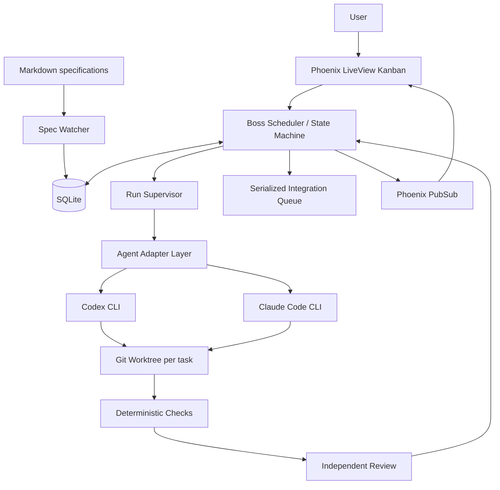
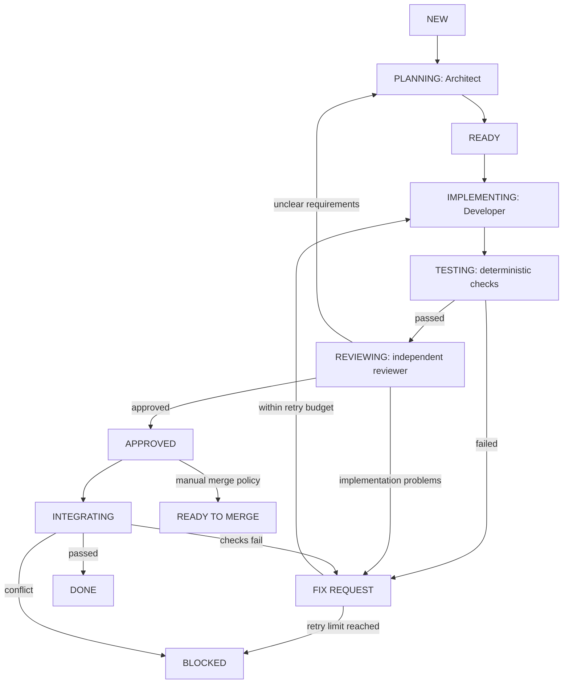

# BOSS — Local AI Agent Orchestrator

> **Status:** Product and implementation plan (v0.1)  
> **Date:** 2026-10-25  
> **Platforms:** macOS and Linux  
> **Primary stack:** Elixir · Phoenix · LiveView · SQLite · OTP · Git worktrees  
> **Product principle:** **Specify → Plan → Implement → Test → Review → Integrate**

## 1. Vision

**Boss** is a small, local-first application that coordinates coding agents already installed on a developer's computer. The user supplies Markdown specifications; Boss turns them into tasks, delegates planning and coding to agents, verifies deliverables, runs independent reviews, and tracks progress on a clean Kanban board.

Boss is **not** another coding LLM, IDE, cloud service, agent framework, or chat frontend. Boss is a deterministic **supervisor** of existing agent tools.

### Core user journey

1. Choose an existing Git repository and its `specs/` directory, or create a new project.
2. Boss detects Markdown specifications and creates Kanban cards (with deduplication and change detection).
3. Boss detects installed/authenticated agent CLIs and offers one-click selection for **Architect/Reviewer** and **Developer** roles.
4. Architect refines the task into implementation notes and measurable acceptance criteria. The original user specification is preserved.
5. Developer implements the task inside an isolated Git worktree and reports completion.
6. Boss runs deterministic checks and asks an independent Reviewer to inspect the spec, diff, test output, and results.
7. If rejected, Developer gets actionable feedback; if the original spec is unclear, Architect revises the task. This repeats within a bounded retry budget.
8. After approval, Boss integrates the branch (or requests manual approval), runs post-integration checks, and marks the task **Done** only when the selected delivery policy is satisfied.

### Non-goals for v0.1

- Running or hosting LLM inference ourselves.
- Custom cloud accounts, billing, or collaboration.
- Supporting every CLI and every model.
- Embedding a full IDE, generic graph editor, plugin marketplace, or MCP server.
- Docker/Kubernetes/remote worker infrastructure.
- Automatic deployment or unattended arbitrary destructive shell actions.

## 2. What to study: competing open-source projects

**Important:** We will learn *patterns* from the repositories rather than copy large chunks of source. Check each dependency and code snippet's license, attribution obligations, and current implementation before reuse. README claims do not replace code review or hands-on testing. Versions and capabilities change over time.

| Project | URL | Inspect for | Avoid copying |
|---|---|---|---|
| **Agetor** (MIT, as reported in README) | https://github.com/alamops/agetor | CLI discovery, harness adapters, tmux/session continuity, `codex exec --json`, JSONL parsing, worktree naming, task → pipeline handoffs, local HTTP authentication | Full workflow canvas, extensive chat UI, many experimental harnesses |
| **Kander** | https://github.com/dualface/kander | Independent reviews, stage gates, reject/repair loop, delivery rules, recovery from failures and conflicts | Heavy process/configuration and premature multi-gate complexity |
| **Orchestrator.inc** (Apache-2.0 as reported in README) | https://github.com/OrchestratorInc/agent-orchestrator | Project-level orchestrator vs task workers, session lifecycle, daemon state, Kanban derived from actual worker/PR state, worktree management | Broad integration set, PR-centric workflows as a prerequisite, browser/phone features |
| **Backlog** (site describes Apache-2.0 open-source engine; check actual repo licenses) | https://backlog.so/ | Dependency DAG, file-scope claims, bounded concurrency, leases/heartbeats, task-to-commit traceability, restart recovery | Complex enforced hooks, multi-repo splitting in MVP |

### Suggested source-code reconnaissance

#### Agetor — first priority

- Begin with `README.md`, `CLAUDE.md`, `src/bun/agents.ts`, `src/bun/agent-status.ts`, and agent-specific driver modules (paths may move).
- Trace **discover → launch → stream → resume → stop** for Codex and Claude.
- Study handling of JSONL and interactive CLI differences.
- Examine where worktrees are created, what survives a GUI restart, and how the UI learns that a run has finished.
- Learn why tmux is used; **do not require tmux for MVP** unless it is justified by a tested reliability requirement.

#### Kander — review engine

- Identify the state machine or rule evaluation logic used for review, retry, and final delivery.
- Find how review execution stays independent from implementation.
- Inspect crash/restart and merge-conflict scenarios.
- Reproduce one rejected review and one approved review in a small local test project.

#### Orchestrator.inc — separation of responsibilities

- Start from repository docs such as `docs/architecture.md` and `docs/backend-code-structure.md` where available.
- Separate facts (processes, files, checks) from derived Kanban status.
- Study worker identity, task identity, repositories, run recovery, integration history, and observable events.

#### Backlog — parallel safety

- Inspect source and documentation linked from the site; **verify the repository URL before adopting implementation ideas**.
- Investigate dependency ordering, exclusive file-scope claims, concurrent worker limits, failure propagation and retries.
- Adopt the simplest viable version: dependency edges + optional predicted file scopes + integration queue.

### Questions to answer during competitor research

1. How does the project distinguish agent exit success from task success?
2. How is a running process identified and recovered after restarting the app?
3. How are agent permissions and user credentials handled?
4. How do separate worktrees avoid source collisions, and how are integrations serialized?
5. How are review verdicts represented and validated?
6. How is state persisted transactionally, and can it be reconstructed from events?
7. Which UX decisions make connection of an existing CLI nearly effortless?

Deliverable: `docs/RESEARCH.md` with links to exact code locations, screenshots when permitted, patterns worth adopting, and tradeoffs. No blind copy/paste.

## 3. Technology decisions

| Concern | MVP choice | Rationale |
|---|---|---|
| Runtime | Elixir / OTP | Process supervision, asynchronous execution, failure isolation |
| HTTP & GUI | Phoenix + Phoenix LiveView | One language end-to-end, responsive local UI, realtime updates |
| Styling | Tailwind CSS + simple local components | Lightweight, consistent dark/light mode; minimal JavaScript |
| Persistence | SQLite via Ecto + Exqlite | Zero external DB setup, durable project/task/run data |
| Spec parsing | Elixir Markdown library (e.g. Earmark), frontmatter parser if needed | `.md` first; avoid over-prescriptive format |
| File watching | FileSystem or a small polling fallback with debounce | Automatic spec refresh without duplicate tasks |
| CLI execution | Erlang Port / supervised OS process adapter; evaluate `ex_cmd` | Streaming stdout/stderr, OS PIDs, controlled shutdown |
| Git | System `git` executable | No custom Git implementation; worktree and diff support |
| Updates | Phoenix PubSub and LiveView | Incremental task and event updates |
| Logging | `Logger`, persisted run events / JSONL | Diagnostics without building telemetry infrastructure |
| Packaging | Initially `mix phx.server` / launcher; later Elixir release + macOS/Linux wrapper | Validate the engine before investing in bundling |

**Design constraint:** Do not assume every agent CLI implements the same features. Adapters advertise capabilities such as `headless`, `streaming`, `session_resume`, `structured_output`, `approval_support`, and `usage_reporting`.

## 4. System boundaries



### Modules / contexts

```text
lib/
  boss/
    application.ex
    projects/
      project.ex
      spec_importer.ex
      spec_watcher.ex
    tasks/
      task.ex
      dependency.ex
      run.ex
      transition.ex
      state_machine.ex
    orchestration/
      scheduler.ex
      task_coordinator.ex
      run_supervisor.ex
      integration_queue.ex
      recovery.ex
    agents/
      adapter.ex
      detector.ex
      registry.ex
      cli_runner.ex
      codex.ex
      claude.ex
      event_normalizer.ex
    git/
      worktree.ex
      diff.ex
      integration.ex
    review/
      acceptance.ex
      verdict.ex
    telemetry/
      event.ex
      usage.ex
  boss_web/
    live/
      board_live.ex
      task_live.ex
      agents_live.ex
      settings_live.ex
```

Suggested interfaces (illustrative contracts, not finalized API):

- `SpecImporter.sync(project_id)` finds new/changed/deleted specs and computes a hash.
- `Scheduler.next_ready_tasks(project_id)` returns tasks not blocked by dependencies and under concurrency limits.
- `TaskCoordinator.start(task_id)` transitions state durably and orchestrates its next step.
- `AgentAdapter.detect/0`, `capabilities/0`, `start_run/1`, `stop_run/1`, `parse_event/1`.
- `Worktree.create(task_id, base_ref)` and `IntegrationQueue.enqueue(task_id)`.
- `Review.accept?(verdict, checks, criteria)` makes deterministic decisions from validated evidence.

**OTP rules:** `DynamicSupervisor` manages task coordinators; isolated subprocess runners have monitored lifetimes; no workflow-critical state lives only in GenServer memory. Recover from SQLite on restart. PubSub notifies the UI; it is not the durable queue.

## 5. Spec and task contract

The user can write ordinary Markdown; YAML frontmatter is optional:

```md
---
id: auth-login
priority: high
depends_on: []
---

# Implement user authentication

## Goal
Users can sign in and sign out securely.

## Acceptance criteria
- Successful login creates a session.
- Invalid credentials are rejected.
- Logout invalidates the session.
- Relevant automated tests pass.

## Constraints
- Use the app's existing authentication library.
```

Import rules:

- A project is a local Git repository plus a watched directory, default `specs/`.
- Use a stable key based on project ID and relative path or explicit frontmatter ID.
- Persist content hashes and spec revisions; do not create duplicates on watcher events.
- If the spec changes mid-run, record that it changed. Do **not** silently overwrite the agent's active snapshot; ask to re-plan/restart or queue a new revision.
- Treat task specs and repository content as **untrusted input** from an execution-permissions standpoint.
- Save the original user spec and refined plan separately. Never let a reviewer silently replace the source spec.

### Working files

```text
project/
  specs/
    001-authentication.md
    002-dashboard.md
  .boss/
    config.yaml           # optional per-project settings, safe to commit

~/.boss/
  boss.db
  projects/<project-id>/
    tasks/<task-id>/
      original-spec.md
      refined-spec.md
      plan.md
      review.json
      events.jsonl
    worktrees/<task-id>/
  logs/
```

The `.boss/` inside the project is **config only**; private run data, logs, worktrees, and generated artifacts live outside the repository by default.

## 6. Workflow state machine

**Internal states:**

`new → planning → ready → implementing → testing → reviewing → approved → integrating → done`

Exceptional states: `blocked`, `needs_input`, `failed`, `cancelled`, `ready_to_merge`.

For simplicity, Kanban columns may aggregate internal states:

- **Backlog:** New, Planning, Ready
- **In Progress:** Implementing, Testing
- **Review:** Reviewing, Approved
- **Needs Attention:** Blocked, Failed, Needs Input, Ready to Merge
- **Done:** Done



### Exact quality gates

A task may pass **implementation** only when:

- Its agent process ended without a runner/protocol failure.
- Required output and commit/diff exist (unless it is explicitly a no-code task).
- Deterministic project checks pass (configured tests, formatter, lint, optional security checks).

A task may pass **review** only when:

- Reviewer is a separate run with a separate role and context; ideally a different agent/model.
- Reviewer sees original spec, refined plan, full diff, test output, and previous review feedback.
- Verdict conforms to a validated schema, e.g. `approved | changes_requested | needs_spec_revision`.
- Reviewer lists failed acceptance criteria and actionable issues for rejected work.

A task may be **Done** only when:

- Review approved, selected integration policy completed, and post-integration tests pass; **or** it is explicitly a non-merged workflow with a separately labeled terminal state.
- Integration is serialized to prevent concurrent main-branch writes.

No LLM should directly mutate state in the DB or bypass validation gates. A model proposes a verdict; Boss validates evidence and applies an allowed transition.

### Review loop controls

- Default maximum review cycles: **3**; configurable per project.
- Classify a rejection as **implementation fix** or **spec revision**; route appropriately.
- Repeated identical failures escalate to `blocked` rather than looping indefinitely.
- Preserve all review reports; show differences between revisions.
- Budget by max run duration and, when reliable telemetry exists, tokens/cost.

## 7. Agent adapters and onboarding

### User-facing onboarding (target: 2–3 clicks)

1. **Add Project** → choose a local Git folder.
2. **Detect Agents** → scan for `codex`, `claude`, optionally `gemini`.
3. Assign **Architect / Reviewer** and **Developer**, then **Start**.

When an agent is installed but not authenticated, show its official sign-in/install instruction. Boss **must not read, copy, or store API keys** from agent authentication files.

### MVP adapters

- **Codex:** use its supported noninteractive CLI and JSON event output when available; normalize messages, errors, tool events, usage, and completion.
- **Claude Code:** use documented headless mode and structured streaming; handle differing permission modes and session semantics.
- **Gemini / ACP / custom CLI:** later; design for extension without implementing them in v0.1.

Avoid hard-coded assumptions about exact CLI flags or output event names. Keep a versioned compatibility test suite for supported agent versions and verify installed binaries' capabilities at runtime.

### Event contract

```json
{
  "run_id": "run_123",
  "task_id": "task_001",
  "agent": "codex",
  "event": "tool_completed",
  "timestamp": "2026-10-25T16:00:00Z",
  "payload": {"summary": "Tests finished", "exit_code": 0}
}
```

Store raw output for debugging (with redaction and bounded retention) and normalized events for UI. Never infer task completion merely because the last assistant message says "done".

### OS-process requirements

- Stream stdout and stderr; do not accumulate unlimited in-memory buffers.
- Correctly detect process exit, signal termination, timeout, and tool requests for approvals.
- Cancel the whole process group when appropriate, not just the immediate shell.
- Record PID/process handle, start time, last event, exit code, and restart strategy.
- Define a clear policy for what happens when the Boss UI/browser closes vs when the Boss backend exits.
- Pause on authorization, permission, missing dependency, and quota errors; do not spin retries.

## 8. Git worktrees and integration

For each task, use a unique branch and isolated worktree outside the repository checkout:

```bash
git worktree add -b boss/task-001 \
  "$HOME/.boss/projects/<project-id>/worktrees/task-001" \
  main
```

The example uses placeholders. Actual commands must use safely validated paths, argument arrays (not shell interpolation), and a verified base ref.

Invariants:

- One writable worktree per active implementation task.
- Explicit immutable base commit recorded when the task starts.
- No two active tasks write to the same worktree.
- The source user's main checkout is not modified during agent development.
- Integration is a distinct serialized operation; worktree separation **does not** eliminate merge or semantic conflicts.
- Before branch integration, check dirty working trees, uncommitted changes, expected branch tip, and original base.
- After integration, run configured tests on the integrated result.
- Keep worktrees for blocked tasks and failed merges; cleanup only after safe success or explicit user action.

### Parallel scheduling (v0.1)

- Default `max_parallel_tasks: 2` (configurable 1–3 initially).
- Respect explicit `depends_on` edges; refuse cycles in dependencies.
- Keep tasks with overlapping predicted file scopes serial **when enough evidence exists**; otherwise flag potential conflicts.
- Use a single integration queue per repository.
- Never claim worktree isolation makes simultaneous changes semantically safe.

## 9. Persistence model

Suggested Ecto schemas / SQLite tables:

| Table | Important fields |
|---|---|
| `projects` | id, name, root_path, specs_path, base_branch, config |
| `spec_revisions` | id, project_id, relative_path, content_hash, original_text, imported_at |
| `tasks` | id, project_id, spec_revision_id, title, priority, state, iteration, assigned_roles, timestamps |
| `task_dependencies` | task_id, depends_on_task_id |
| `runs` | id, task_id, role, adapter, model, process_id, state, start/end, exit_code, error |
| `run_events` | id, run_id, sequence, event_type, payload, timestamp |
| `reviews` | id, task_id, run_id, verdict, issues_json, acceptance_json |
| `worktrees` | id, task_id, path, branch, base_commit, head_commit, state |
| `integrations` | id, task_id, target_ref, commit, status, check_results |
| `agents` | id, name, adapter, executable_path, capabilities, last_probe |

Use DB transactions for state changes and event persistence. Store unique/idempotency keys so duplicate CLI completion messages, watcher notifications, and process restarts cannot run a transition twice.

**Recovery:** On application boot, reconcile DB state with existing worktrees and OS processes. Classify orphaned or interrupted runs. Do not automatically repeat potentially destructive commands without first confirming their prior effects.

## 10. Minimal UI

Design language: calm, compact, Linear-inspired; excellent keyboard navigation; dark and light themes; no busy node canvas.

**Screens:**

1. **Projects** — choose local folder, project status.
2. **Board** — Backlog / In Progress / Review / Needs Attention / Done; card shows role, agent, iteration, elapsed time.
3. **Task drawer** — original spec, refined plan, acceptance criteria, live events, changes, tests, reviews, worktree/branch.
4. **Agents** — detected CLI tools, version, auth/probe status, role assignment, safe permissions.
5. **Settings** — concurrent runs, max review cycles, auto/manual integration, check commands, run budgets.

Keep manual controls limited: **Start, Pause, Resume, Retry, Stop, Approve Merge**. Every control must update persisted state, not just client state.

## 11. Security and local-first requirements

- Bind HTTP only to loopback (`127.0.0.1` / `::1`) unless user explicitly changes it.
- Protect mutating endpoints and WebSocket sessions against unauthorized local/web-origin access; use session/CSRF protection, origin validation, and suitable authentication/token controls even on loopback.
- Worktrees are **not sandboxes**. Respect agent sandbox modes and require explicit approval for broader filesystem/network/command access.
- Do not default to dangerous bypass flags, arbitrary `--dangerously-*` modes, or unconstrained shell access.
- Keep credentials in their provider CLI, not Boss. Redact secrets from persisted logs and UI.
- Treat `.md` files, Git commits, test output, issues, and all model messages as untrusted content; never turn model text into raw executable shell commands.
- Use argument-safe process execution; validate filesystem paths and prevent traversal/symlink escapes.
- All external network connections are performed only by user-selected agent CLI or explicitly enabled integrations; Boss itself needs no cloud backend.

## 12. Roadmap and definition of done

### Phase 0 — competitor research & executable spike

**Build:** `docs/RESEARCH.md`; basic CLI-probe prototypes for Codex and Claude; Git worktree spike; verify SQLite/Phoenix setup and packaging options.

**Acceptance:** At least one agent successfully executes a harmless task in a scratch worktree; we capture a streamed event and an exit code; competitor findings cite concrete code paths.

### Phase 1 — local application skeleton

**Build:** Phoenix LiveView app, SQLite migrations, project CRUD, folder chooser/path selection, `.md` watcher and importer, board UI, config.

**Acceptance:** Adding 3 Markdown specs creates exactly 3 cards. Editing one spec updates its revision without duplication. Tasks persist after restart.

### Phase 2 — one reliable agent run

**Build:** Codex adapter, CLI discovery, runner lifecycle, process monitoring, event normalization, live logs, Git worktree creation, cancellation.

**Acceptance:** Run a task in a separate worktree, see logs live, stop/retry, preserve changes and recover a crashed run without falsely marking it successful.

### Phase 3 — architect/developer/reviewer loop

**Build:** Claude adapter, planning prompt, typed handoffs, deterministic test runner, independent review schema, feedback loop, bounded retries, blocking states.

**Acceptance:** A deliberately incomplete implementation fails review; feedback returns to Developer; the repaired implementation passes; reviewer failure does not yield `done`.

### Phase 4 — concurrent scheduler & integration

**Build:** dependency DAG, max concurrency, multiple worktrees, integration queue, conflict handling, post-integration checks, manual merge policy.

**Acceptance:** Two independent tasks execute concurrently and integrate sequentially; dependent work waits; a conflict safely blocks instead of modifying main silently.

### Phase 5 — robustness, polish, and distribution

**Build:** startup recovery, secure loopback, log redaction, permissions/approvals, light/dark UI polish, CLI version tests, Elixir release, macOS/Linux installer or wrapper.

**Acceptance:** A fresh macOS/Linux user with one supported CLI can add a project and execute a task with at most 2–3 straightforward setup actions **after the CLI is installed and logged in**. No Postgres, Redis, Docker, or external Boss service required.

### Explicit MVP finish line

A user places `001-login.md` in `specs/`; Boss imports it, creates a worktree, asks Architect to refine it, asks Developer to implement, executes checks, runs independent review, returns actionable feedback on failure, integrates on success (per selected policy), and shows a truthful final board state. All major state persists across a Boss restart.

## 13. Test strategy

- **Unit:** spec parser, state transitions, dependency cycles, verdict validation, CLI event parsers, conflict classification.
- **Contract:** fixture-based tests per CLI adapter; compatibility matrix for supported versions.
- **Integration:** throwaway real Git repos/worktrees; deterministic fake agent CLI for success, errors, stalls, invalid JSON and cancellation.
- **System:** real Codex/Claude smoke tests opt-in (require installed/authenticated CLIs; never in normal CI).
- **Recovery:** kill backend mid-run; restart, reconcile, verify correct task state and safe retry.
- **Security:** symlink/path traversal, malicious Markdown instruction strings, CSRF/origin, leaked secret in logs, command injection attempts.
- **UI:** LiveView component tests, keyboard navigation, dark/light contrast, 3-task happy path.

## 14. First implementation tickets

1. `BOSS-001` Phoenix project, Ecto SQLite, config, local-only server.
2. `BOSS-002` Project and spec revision schemas/migrations.
3. `BOSS-003` Markdown directory importer with idempotent hash sync.
4. `BOSS-004` Task state machine and transition tests.
5. `BOSS-005` Minimal LiveView board and task drawer.
6. `BOSS-006` Agent detector and capability probe UI.
7. `BOSS-007` Robust streaming OS runner with cancellation.
8. `BOSS-008` Codex CLI adapter, JSONL event parser and contract tests.
9. `BOSS-009` Git worktree lifecycle and safety checks.
10. `BOSS-010` Task coordinator + durable run/event journal.
11. `BOSS-011` Architect planning prompt, typed plan output.
12. `BOSS-012` Claude CLI adapter and schema-constrained review output.
13. `BOSS-013` Test runner + independent acceptance gate.
14. `BOSS-014` Bounded review/fix cycle; blocked/needs-input states.
15. `BOSS-015` Concurrent scheduler + dependency handling.
16. `BOSS-016` Serialized integration and post-merge checks.
17. `BOSS-017` Recovery/reconciliation and error UI.
18. `BOSS-018` Security hardening and local packaging.

Each ticket should contain: goal, touched areas, dependencies, acceptance criteria, tests, and rollback/failure behavior. Start with Phase 0 and `BOSS-001` through `BOSS-004`; do not build a generic AI orchestration framework first.

## 15. Key decisions to revisit after MVP

- Should the agent runner use direct processes or optional tmux for restart-surviving sessions?
- Should ACP become the preferred adapter when supported agents reach reliable compatibility?
- Is `READY TO MERGE` the default terminal state for manual mode, rather than `DONE`?
- How much file-scope prediction is needed before overlapping-task scheduling becomes useful?
- Is a bundled desktop shell justified, or is a one-command local browser app sufficient?

**Default answer:** choose the least complex solution that demonstrably completes the full spec → reviewed code loop.

## 16. References

### Existing products / source

- Agetor: https://github.com/alamops/agetor
- Kander: https://github.com/dualface/kander
- Orchestrator.inc: https://github.com/OrchestratorInc/agent-orchestrator
- Backlog: https://backlog.so/

### Technical documentation (verify against installed versions)

- Phoenix LiveView: https://hexdocs.pm/phoenix_live_view/
- Elixir DynamicSupervisor: https://hexdocs.pm/elixir/DynamicSupervisor.html
- Ecto: https://hexdocs.pm/ecto/
- SQLite adapter Exqlite: https://hexdocs.pm/exqlite/
- Git worktree: https://git-scm.com/docs/git-worktree
- Codex non-interactive mode: https://developers.openai.com/codex/non-interactive
- Claude Code headless mode: https://code.claude.com/docs/en/headless
- Agent Client Protocol: https://agentclientprotocol.com/

---

**BOSS guiding principle:** *Agents think and code. Boss coordinates, validates, and keeps an auditable record of what actually happened.*
