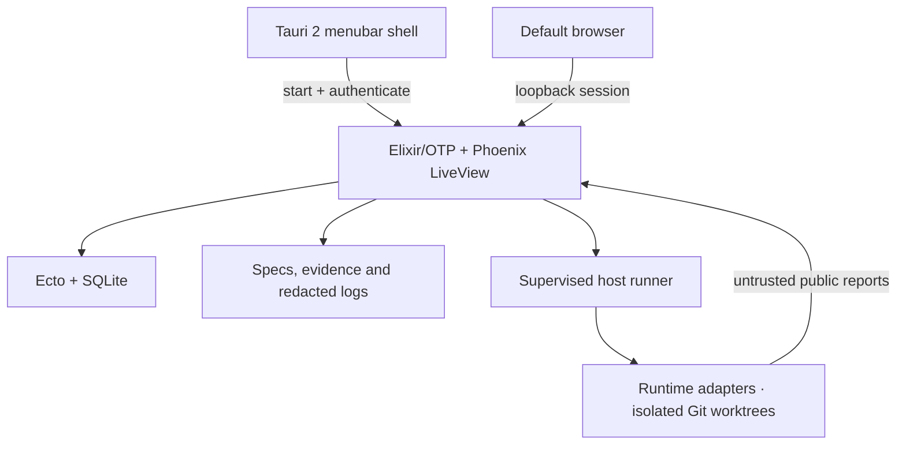

# Architecture

R060t `arena_git::guest_check::recovery` owns a fixed read of complete retained
guest-check proof. `Store::retained_run` opens the existing namespace without
creating it; the only executable read is the fixed private keeper artifact.
The reader reuses current image/candidate verification, reconstructs expected boot
bytes in memory and checks original admission/intent/publication/receipt/output.
It launches no VM/provider, changes no artifact and returns the original bound
result as historical data. A 60-second native/65-second caller budget never
extends execution authority. No Phoenix recovery consumer or Start grant is added
in this prerequisite; an interrupted check still needs inspection. The subsequent
consumer must bind all original ordered checks and explicit paused checkpoints.
[Contract](../tasks/R060t-retained-guest-check.md).

R050r `CheckFeedback` owns the opt-in failed-check schema, exact immutable
attempt/check/candidate binding, prompt projection/reservation and public metadata.
The existing native `guest_check` owner transforms already verified output before
publishing its private receipt; there is no new log reader/process/tool. GuestChecks
separates the excerpt from check metadata, Receipts checks the bound envelope,
and normal domain transitions retain/clear feedback through repair/new checks.
BattleExecutor labels it untrusted and preserves the 32 KiB prompt limit. The
existing guarded task history shows counts only; Evidence omits text/private
request IDs. Schema twenty-one adds the update-shape fence/older-bundle refusal.
Normal setup and OTP worker ownership are unchanged.

R050q connects task planning to those guest checks. `Planning` validates the
closed `brief-plan-v4` proposal; `Tabulae` stores profiles in immutable task
revision content. `TaskChecks` owns profile validation, fixed command resolution,
stable content IDs and exact frozen membership. `Snapshot` freezes the union
with configured Arena checks. `Battles` records integrated task IDs atomically
with the reviewed head, then derives each check-stage scope. `GuestChecks` and
`Receipts` bind execution and independent review to the original attempt and
candidate. The existing LiveView task dialog uses stateless verification
components; no additional setup route or worker/coordinator is introduced.
Migration twenty fences older bundles and checks optional revision-array shape;
domain validation owns full profile/budget rules. Historical absent fields keep
their original serialization and grants. [Contract](../tasks/R050q-task-checks.md).

R050p connects declared offline npm/Mix checks to the existing Arena stage worker.
`GuestChecks` owns the frozen grant, literal command binding, exact-candidate
capsule/VM calls and closed public receipt validation. `CheckImage` embeds the
native image/keeper/process/build identity and queries only completed audited
admissions for reuse. `BattleExecutor` performs installation/verification during
admission, then checks through cancellable NativeHelper Ports in supervised tasks;
the coordinator remains responsive. `Battles.Receipts` binds independent review
to the exact original completed check attempt, never the reviewer's newer ID or
another task. Unverified native attempts retain global capacity. Migration nineteen
adds bounded image/reservation query indexes and the old-bundle fence. Start keeps
one button and describes first-use downloads/offline limits. Historical system
grants remain unchanged; automatic task-selected tools, dependencies/platforms,
keeper recovery and real-provider/release acceptance remain open.
[Decision](DECISIONS.md#d062--admit-isolated-checks-through-the-existing-arena-worker).

R050o introduced native `arena_git::guest_check` as a fixed operation. It
reuses image and committed-candidate verification, retains an exact scoped intent,
and starts only the compiled embedded Swift keeper. `build.rs` compiles/signs that
dedicated Apple Silicon/macOS13 helper; build identity also covers its source and
entitlement. The tray shell gets no new entitlement. Guest boot copies use private
descriptor-bound APFS clones (exclusive bounded-copy fallback), never host shares.
Swift owns the VM/deadline/liveness pipe, exact frame decoding and SDK Stopped;
Rust owns the helper group and final receipt. Their closure facts stay separate.
Only after both verify does Rust publish bounded public metadata. A single-use
run namespace and admission are reserved before preflight; replay never closes
an earlier run or overwrites its proof. Captured
output remains a private hash-bound file. There is no new SQLite state/command,
provider permission or Start grant in that slice; R050p admits it only through
its separate frozen policy. Wrapper-loss VM-only observations never authorize recovery or release.
[Decision](DECISIONS.md#d061--keep-the-vm-owner-independent-until-native-shutdown-is-recorded).

R050n puts the fixed image installer and production guest programs in native
`check_image`. `store` owns descriptor-relative exclusive private artifacts;
`archive` composes pinned TAR/ZIP inputs into deterministic newc without host
extraction. Explicit CLI install/verify is bounded/cancellable and binds compiled
input/source digests plus the original full receipt. Guest PID1/root control owns
deadlines and result framing outside the unprivileged resource group; only a
fixed npm/Mix runtime receives bounded literal arguments. Worker output is separate
data. The installer grants no VM launch or Start authority. R050o above supplies
the native keeper; R050p above owns supervised OTP admission and frozen grants.
[Decision](DECISIONS.md#d060--install-fixed-guest-inputs-and-keep-control-outside-project-execution).

R050m implements isolated-check candidate transport inside the existing native
Git boundary. `worktree/check_input.rs` owns descriptor-relative private artifacts,
deterministic newc and read-only verification against immutable blobs.
`inspection::each_blob` reuses the existing bounded blob parser; portable prefix
validation is shared with combination without changing its conflict semantics.
`LocalGit` exposes only bounded public scope/count/hash fields. There is no new
UI command, database state machine or worker; future supervised battle execution
must still freeze/admit the image, grant and exact receipt. The archive cannot
run a toolchain or establish task completion by itself.
[Decision](DECISIONS.md#d059--transport-exact-candidate-bytes-through-a-private-native-capsule).

R050l extends only the disposable guest probe. Python composes pinned toolchain
files and synthetic committed candidates into a private ramdisk; Swift decodes a
separate privileged channel. Worker output stays data, bound by byte count/hash.
Request/candidate/toolchain-policy/command identity and native Stopped are both
required for a successful retained observation. Complete kernel/ramdisk hashes
are separate from that policy digest. Neither SQLite nor the production check
adapter accepts this prototype contract. Shipping image/candidate transport,
keeper-loss ownership and frozen grant/OTP/UI integration still need implementation.
[Decision](DECISIONS.md#d058--bind-actual-guest-checks-separately-from-worker-output).

R100d's optional held smoke mode extends only the existing native Service
lifecycle, with fixed readiness, normal heartbeats and bounded release/shutdown.
The source-only synthetic fixture builder leaves an unsettled native claim in a
fresh private workspace. The sealed release runs its unchanged production OTP
recovery; SQLite observations establish the result. No fake provider, workflow
command or grant override is added to the release.
[Decision](DECISIONS.md#d055--hold-only-the-existing-smoke-lifecycle-for-packaged-recovery-checks).

R060s extends `Battles.CandidateRecovery` only under the new combination policy:
one exact interrupted combination uses the existing exclusive supervised queue.
`BattleExecutor` calls the fixed native retained read, which reuses combined-tree
verification. Battles appends the observation and pauses a verified checkpoint;
the claim stays Interrupted, reviewed head stays unchanged and checks/review stay
fresh. MixedClosure excludes combination members. [Decision](DECISIONS.md#d054--recover-complete-combined-candidates-without-replay).

R100c `Database` refuses future/unknown schemas and calls `UpgradeBackup` before
pending migrations of an existing known schema. Under the launcher lock, the
startup process owns consistent SQLite copying, readonly checks, bounded hashing
and synchronized private receipts. It completes before authentication/dispatch/HTTP.
Settings reads only dated metadata from the fixed pointer; it cannot restore or
establish current integrity. No new schema, native operation or provider grant.
[Decision](DECISIONS.md#d053--verify-a-private-database-copy-before-startup-migration).

R060r `Battles.TaskBlocks` binds task-local attention to an immutable validated
attempt/receipt. Battles owns settlement, controls, cleanup/deadline/binding gates
and transactional continuation; Waves excludes blocked lanes and opens only ready
independent work. The existing supervised runner dispatches those claims without
new mailbox loops or tools. LiveView projects task/Arena attention; it cannot grant
continuation. Migration eighteen prevents old bundles and direct blocked-task
claims. [Decision](DECISIONS.md#d052--verified-task-local-attention-may-permit-independent-work).

R020s separates exact Codex setup and execution cohorts. Native `codex_versions`
is shared by OS diagnostics/checks; host Codex exposes the matching bounded list.
Isolation captures the selected connection's actual version and settlement binds
the receipt to that version plus existing identity/command guards. Additional
native action/daemon defaults are disabled, not granted by compatibility. A
test-only no-inference preflight checks effective policy/thread metadata and is
absent from release CLI/API. [Decision](DECISIONS.md#d050--verify-exact-codex-cohorts-and-bind-isolation-versions).

R060q keeps Codex typed failure parsing in native `connection/task_turn.rs`.
Only normalized public codes cross TaskTurn; raw errors never do. New snapshots
freeze backoff v2; Backoff validates bounded persisted jittered overload windows,
and Battles retains exact claim/retry/cleanup authority. Native internal retry
notifications consume the same original turn. v1 retains its historical rules.
[Decision](DECISIONS.md#d049--separate-typed-provider-failures-from-retry-authority).

R060p adds `Battles.MixedClosure`: a new immutable Start policy queues exact
provider-then-native retained reads for one interrupted provider/capture-or-
preparation pair. Existing BattleRunner supervised workers commit observations
before notification. Provider closure retains its separate capacity semantics;
native observations grant Stop cleanup only, never settlement/checkpoint authority.
No original claim/card/head is rewritten or advanced. [Decision](DECISIONS.md#d048--inspect-mixed-interrupted-claims-for-stop-only).

R100b embeds the same public build manifest in the native shell and Phoenix BEAM.
The shell verifies the release copy before data preparation; runtime configuration
verifies its compiled UUID/digest before migration/dispatch. Settings exposes the
validated observation only. Source UI has no packaged identity. The builder hashes
enumerated application inputs and retains sealed-artifact hashes, without granting
workflow authority or proving release acceptance. [Decision](DECISIONS.md#d047--bind-local-packages-to-an-explicit-build-identity).

R060o adds fixed retained-candidate recovery. New Starts freeze
`candidate_recovery: retained-candidate-wave-v1`. One/two exact interrupted
captures or a mixed capture/preparation pair queue exclusive supervised reads.
The native read requires original intent/publication/receipt, exact files,
preparation/battle tag and current source/ref/owned bytes. Missing evidence is
never rebuilt; no capture/provider turn repeats. Each observation is separate
from its immutable Interrupted attempt. All members must verify before one
atomic Paused checkpoint, with unchanged slots/bindings/budgets/deadlines.
Expired/fenced reads permit verified Stop only. Other native/provider/sleep
recovery remains open. [Decision](DECISIONS.md#d046--recover-complete-retained-candidate-checkpoints).

R050h adds version-four workflow stages with explicit read/write access and
before/after Implementor placement. Start freezes `write-role-stages-v1`; prior
read-only/missing policies never acquire write authority. `Battles.Stages` owns
order/access/continuation; `Battles.Writers` reads bounded immutable successful
writer attempts for the exact task/preparation and folds cumulative final hashes.
Every writer captures an immutable candidate before the next role; later turns
verify that checkpoint. The original worktree/head/index and source checkout stay
unchanged by capture. Independent task/final review and serialized integration
remain mandatory. Writer retry starts fresh preparation/Speculator; interrupted
captures remain inspection gates. No native operation or runtime tool is added. The seventeenth migration
indexes writer evidence and blocks older bundles before authentication/dispatch;
back up first. [Decision](DECISIONS.md#d045--explicit-custom-writer-checkpoints).

R050g moves fixed stage order/responsibility into pure `Battles.Stages`, extending
it only from the frozen read-stage policy. `Workflows` owns validated metadata;
Battles still owns claims/transitions, Waves schedules the same bounded lanes and
BattleExecutor uses its existing read-only provider path. Public findings augment
the Speculator plan. Snapshot resolves selected extra roles; unused planning roles
stay outside execution. The guarded Advanced editor reuses the revision ledger,
with no native operation, migration, dependency or extra normal setup screen.

R040o puts per-board workflow state in `Workflows` and its immutable revision
ledger. `Tabulae.get/2` projects current labels; new Start snapshots freeze that
definition/revision. `WorkflowComponent` uses the shared native dialog under
Advanced with its own session/scope/form/revision guards and explicit draft
discard. Active planning/battles block edits transactionally. Native/provider
work, core stage order and grants were unchanged in that initial slice; R050g/h
extend its ledger with actual custom stages above. The sixteenth migration is
additive with virtual legacy revision zero.

R040n keeps optional planner choice inside `Planning` and its existing modal
component. The domain resolves only the board's assigned immutable team and binds
the chosen role/connection/model/sources to consent and the retained command.
Native no-tools planning and automatic card import are reused; role selection
cannot adopt teams or alter battle dispatch. Old requests remain readable.

## Implemented boundary · reviewed 2026-10-22

Cuckoding delivers authenticated setup, planning, isolated task turns and the
Codex/Cursor battle loop with two-task implementation waves sharing two global
workers. Checks/review/integration remain serialized within each board.
Real-provider parallel acceptance and full recovery remain unfinished.
The later sections describe the target architecture, not additional shipped code.

Startup: Repo → schema validation/pre-migration copy/migration → PubSub → shell authority →
supervised setup/battle execution groups → loopback Endpoint → readiness message. SQLite is authoritative;
LiveView owns unsaved forms, not workflow progress. The native shell owns the
release process group and private storage lock.

| Current source | Responsibility and durable owner |
| --- | --- |
| `Database`, `UpgradeBackup` | Before-migration verified database copies and private immutable receipts; fixed dated Settings projection, no restoration authority |
| `Agents`, `Foundation`, `Dispatcher`, `records.ex` | Idempotent commands, expiring claims, append-only events and setup projections in SQLite; a responsive coordinator dispatches one monitored setup/planning task |
| `ExecutionSupervisor` | Separate `one_for_all` groups pair each coordinator with its Task.Supervisor; old workers stop before coordinator recovery |
| `BattleClock` | Independent UTC/monotonic sampling in the battle execution group; SQLite timing fences precede admission, cancellation and receipt settlement |
| `ShellAuth`, web session guard | One-time shell/browser handoff and expiring DB sessions; stateful components must guard their own events |
| `Battles.idle_sleep_requested?`, native `power.rs` / `service.rs` | SQLite-derived bounded eligibility through the authenticated shell heartbeat; one OS-timed idle-system sleep assertion. ShellAuth retains transient last-report age and state-change audit events; no power observation grants workflow authority |
| `Codex`, `Cursor`, native `connection.rs` / `model_check.rs` / `cursor/task.rs` | Private-profile authorization, model catalogs, Codex diagnostic and provider-specific no-tools planning; SQLite retains only normalized public receipts |
| `Foundation`, `Codex`, native `isolation.rs` | Optional fixed two-workspace sandbox canaries, fresh empty runtime profile, executable-bound command/event receipt; no inference or Arena grant |
| `Team`, `TeamAssignments`, `TeamLive` | Immutable default/scoped revisions, explicit scoped edits/adoptions and transactional current-role unassignment on accepted logout; one editor bound to a validated mount-owned scope, command-kind default projection; no provider launch or permission grant |
| `Arenas`, native `folder.rs` | Native folder selection and confirmed directory identity; registration reads metadata only |
| `Tabulae` | Immutable default boards, revisioned Specs/ToDo drafts, acyclic prerequisites and proposal import provenance; delivery columns stay locked |
| `Planning`, `PlanningDocuments`, native `arena_git/documents.rs` | Freeze team/model/brief and optional manual/folder text snapshots in commands; bounded descriptor-relative source collection, then validate proposals and atomically create draft cards |
| `ProjectChecks` | Immutable Arena check declarations, explicit preview/consent and atomic command/revision/event saves; no executable resolution, filesystem access or execution |
| `Battles`, `BattleRunner`, `BattleExecutor`, `BattleChecks`, `Battles.Capacity` | SQLite battle/task/attempt authority and capacity checks; two monitored workers across isolated Arenas; per-task wave claims, serial review and one provider turn per exact connection; closed native Git, provider turns and disposable check workspaces |
| `Battles.Stages`, `Battles.Writers` | Frozen stage order/access and exact successful writer evidence; bounded cumulative file hashes for successive retained native checkpoints, no independent completion authority |
| `Battles.CandidateRecovery`, native `arena_git/worktree/battle/candidate_recovery.rs` | Exact retained capture/preparation proof and exclusive recovery queue; immutable observations, atomic paused checkpoints and no native replay |
| `Battles.Receipts` | Closed result envelope and stage/provider/session/candidate/check evidence validation against an immutable attempt; read-only session-reuse query, no settlement or launch authority |
| `BattlePreview` | Read-only aggregation of scoped saved preparation and verified spec artifacts; no durable battle state or launch authority |
| `Dashboard`, `DashboardComponent`, `ActivityComponent` | Bounded read-only Arena/latest-battle/task/setup/planning projections, exact-board team/progress and 20-event chronological pages; shared stateless worker rows, guarded parent/component events and stable reading mode; no execution authority |
| `Battles.Evidence`, `TaskEvidenceComponent`, `SessionController.task_evidence` | Exact Arena/Tabula/draft/execution read scope, whitelisted frozen/public receipts and cursor-paged task attempts inside the existing dialog; authenticated bounded JSON download of the same projection; no workflow transitions or provider/file access |
| `Specifications`, `Storage` | Freeze accepted draft/prerequisite revisions, write private Markdown, verify artifact hash and atomically commit acceptance/history/ToDo; no execution authority |
| `ArenaGit`, `NativeHelper`, native `arena_git.rs` | Fixed inspect/init/initial-commit/detached-worktree operations and descriptor-relative selected file reads; no remotes, hooks or arbitrary commands |

R070b owns combined-candidate preparation in native
`arena_git/worktree/battle/combined.rs`. It verifies the original writer receipt,
captured paths and current reviewed head under the repository lock, builds a
compatible tree through a private index and retains an exclusive UUID ref/receipt.
Existing review-worktree and CAS consumers verify that exact combined candidate;
post-CAS recovery verifies retained objects against its own live ref boundary.
`LocalGit` exposes only the closed public receipt. R070d adds SQLite lane state, scheduling and independent combined review on this
proof. The primitive alone introduces no provider/tool grant or migration.

R070e keeps exact role-pair selection in `Battles.Slots`. Team owns optional
second catalog bindings and immutable definition v2; its existing LiveView reuses
function-component selectors. Snapshot resolves all pairs before Start; each task
gets durable wave slot 0/1. Capacity never picks a substitute. Admission and
controls validate every frozen binding, while attempts retain the chosen pair.
Only extra-equipped new waves prioritize earlier planning stages. Final stages
and configured checks use primary roles; old snapshots/planning remain unchanged.

R070d owns ready-task wave selection and task stage projections in
`Battles.Waves`; `Battles` retains transactional claims/settlement/controls.
`BattleRepository` serializes native I/O by pinned repository identity in the
supervised worker with bounded cancellable waiting. It grants no native ownership
or cleanup authority. The fifteenth migration changes only claim uniqueness;
old snapshots retain sequential admission. Two global workers and one provider
turn per exact connection remain. R070e supplies explicit paired bindings.

R080a keeps dialog presentation in `CuckodingWeb.Dialog` and the small native
`assets/js/dialog.mjs` hook. LiveView/domain owners still validate every action;
opening, closing or following a dialog hash launches no provider. Native dialogs
handle focus trapping/Escape; the hook retains open state and returns focus.
Foundation distinguishes picker/diagnostic freshness from reusable saved role
bindings and keeps native dispatch validation unchanged. Disconnect reuses the
accepted logout transaction and TeamAssignments; no new worker/schema is added.
R080b adds a short SQLite-only `disconnect_agent` command when executable
verification is unavailable. Foundation reuses TeamAssignments and connection
invalidation atomically, records a local-only receipt and does not dispatch a
native worker. Validated native logout remains asynchronous and unchanged.
[D032](DECISIONS.md#d032--local-disconnect-when-native-logout-is-unavailable).

R012 keeps setup, local previews and planning globally serialized while their
provider/native receive loops run in separate BEAM task processes. Dispatcher
handles correlated task results, `:DOWN` and login-progress messages without
waiting for provider I/O in a GenServer callback. The battle runner retains its
separate monitored task group. R070a replaces its single global job with two
worker slots and fair rotation across ready Arenas. SQLite claims enforce global,
per-battle and exact-connection exclusion; uncertain provider cleanup reserves
its connection. Historical Starts and retained integration recovery stay
exclusive. Setup remains one command. R070d adds bounded independent task waves;
older per-board policies stay sequential. [D034](DECISIONS.md#d034--concurrent-isolated-arenas).

Each execution group stops its old tasks before restarting its coordinator.
R060f makes workers call the existing Foundation/Battles settlement transaction
before returning a completion signal. Coordinators do not settle that notification
again; a queued/lost message cannot erase a committed receipt. Setup terminal facts
survive startup; completed battle boundaries use the existing Paused/Resume path.
Unexpected worker execution/settlement errors exit with a fixed reason before Task
can log private payloads; monitor handling retains interruption/unknown cleanup.
Rollback or uncommitted native effects still require inspection, never replay.
External setup claims found running/cancelling at startup, or whose task dies,
become interrupted transactionally without replay or assumed native cleanup.
Metadata discovery keeps its existing bounded lease recovery. Login progress is
accepted only from the current task and live claim; URLs remain transient in
dispatcher-owned protected ETS and the protected redirect. OTP status/error
reports redact dispatcher messages/state/reasons/debug logs. Their absence after
restart does not invalidate historical authorization observations.

R060k shares `probe::Group::finish` across version, Codex/Cursor, Git and isolation
children. It caches a bounded closure result, pins the leader until final signals
and never signals after reaping. Native receipts carry verified/uncertain cleanup;
the shared bounded Elixir decoder retains false flags and refuses malformed ones
before adapter projection. Cancellation cannot promote either to verified closure.
Uncertain Cursor groups retain their private runtime store. No worker, grant,
schema or interrupted-session recovery is added.

R060g uses the same supervised battle worker for fixed read-only native
`recover_integration`. Startup records a pending inspection only for new-policy
restart-interrupted integrations with otherwise settled history. The native
repository lock serializes verification of exact retained intent/publication/
receipt, current ref, candidate ancestry and owned worktree/source. No mutation
is replayed. `Battles.reconcile_integration/3` retains the interrupted attempt
and atomically appends an observation plus a paused checkpoint; expired effects
close cleanup for Stop without advancement. Inspection and DB settlement remain
separate; a crash may repeat the read, never the integration. The existing Inspect
component renders pending/normalized observations. [D029](DECISIONS.md#d029--retained-integration-reconciliation).

R060m reuses that exclusive supervised dispatcher for fixed
`recover_battle_worktree`. Native `battle/preparation.rs` verifies retained writer
receipt/tag plus existing raw-byte ownership inspection. `Battles.PreparationRecovery`
validates closed exact observations; Battles alone appends the dated receipt and
Paused checkpoint atomically. Reads may repeat after a coordinator crash; native
preparation and the Interrupted attempt never replay or change. [D041](DECISIONS.md#d041--retained-preparation-checkpoint).

R060n uses the same validator/dispatcher for two exact interrupted preparations.
SQLite owns the ordered read queue and observations. Battles verifies every
member/deadline before one atomic two-task Paused checkpoint; failed/mixed or
fenced waves retain only known closure. No native helper change or new worker
kind. [D042](DECISIONS.md#d042--atomic-retained-preparation-wave).

R060h adds BattleClock before the task supervisor/coordinator in the battle
one_for_all group. Its independent timer and synchronous checks observe UTC and
monotonic deltas; it performs only short domain transactions, no provider I/O.
Admission, helper active checks and worker settlement check it without depending
on the coordinator's mailbox. A lost guard stops old workers before restarting
the baseline. SQLite stores the fence, rejected receipt and verified closure;
the clock process never owns workflow progress. The existing Inspect component
shows observations after reconnect. [D030](DECISIONS.md#d030--conservative-timing-gap-fence).

R060l `task_closure.rs` retains an exclusive task intent and fsynced closure file
inside `provider-closures/<attempt UUID>`, outside the empty runtime scratch.
Only public closure metadata and
the frozen binding/hash are stored, never prompts, reports or provider frames.
`Battles.ProviderClosure` normalizes the fixed read-only helper response. Existing
BattleRunner supervised recovery dispatch appends a separate SQLite observation
before notification. The interrupted attempt remains immutable; confirmed Stop
and exact-connection capacity can use verified closure, while ordinary settled
stage/Resume/Retry/Skip predicates deliberately do not. No migration or provider
session replay is introduced.

R060i keeps the native shell an actuator. Phoenix computes eligibility for new
`shell-lease-v1` battles from saved state/deadlines; it sends only a fixed boolean
and 15-second contract in `/shell/status`. The native five-second heartbeat
renews one owned IOKit assertion, explicitly timed to TurnOff, and releases it on
idle, shutdown, transport/protocol failure or drop. Assertion failures remain
nonfatal and cannot widen permissions. ShellAuth authenticates fixed native
reports atomically with shell authority, audits changes only and caches their
age for Settings; restart returns Unknown. Durable battle state remains the only
eligibility authority. [D031](DECISIONS.md#d031--native-idle-sleep-lease).

Every application screen is an authenticated LiveView. Layouts/dialogs use HEEx
function components, and the four stateful form/control components share
`CuckodingWeb, :live_component` with verified routes. Their explicit per-component
session event guards remain mandatory. Authentication, redirects, downloads and
shell protocol retain controller boundaries; the public static site stays separate.

R020r routes initial planning to the exact frozen Codex/Cursor connection. Cursor
reuses its isolated ACP config/model selection/cleanup path but never constructs
the host Files service. A separate two-minute no-tools operation returns the same
bounded proposal contract plus exact runtime-model parameters. Planning validates
the provider-specific receipt before existing atomic graph/card creation. The
shared ACP input writer owns stdin in a thread and has one queued bounded frame;
the main helper remains able to observe cancellation/deadlines and close its group.
No LiveView/GenServer callback waits for native/provider I/O, and no migration or
new command kind is needed. Codex historical planning keeps its original grant.

R040f reuses the native pinned-directory reader for up to four selected `.md`/`.txt`
files without running Git. A local `preview_documents` command stores exact text,
relative paths, byte counts and SHA-256; events omit content/paths/hashes. A
separately consented `plan_tabula` freezes the scoped, fresh preview reference and
text. The provider receives untrusted snapshots on stdin, under the unchanged
empty-scratch/no-tools grant; it never receives the Arena root. No new worker,
dependency or migration is introduced. See [Security](SECURITY.md) for limits.

R040g stores prerequisite IDs in existing immutable draft revision JSON. Current
tasks join their matching revision; save validates the current board graph inside
the immediate transaction before projection/history/event writes. No new table,
worker or scheduler is needed. The graph is loaded per save; query reachable
edges if board size makes this too costly.

R040h introduced `brief-plan-v2`; R040l uses `brief-plan-v3` for up to 16 sources.
Task references use earlier
proposal indices; citations use frozen document indices. Elixir binds both to
the saved contract/request before persistence. Tabulae resolves prerequisite
indices through completed same-board import receipts in the existing transaction.
Original citations remain reachable through the import command after draft edits.
The native transport still uses the same no-tools scratch grant. No new migration.

R040i reuses commands as accepted-spec receipts. Preview generates literal Markdown
from saved task/prerequisite revisions and original citations. A consented command
persists intent before an exclusive private file write; completion hash-checks
the file and current revisions, then commits acceptance, draft history and ToDo
atomically. Missing/changed files cannot be downloaded. Later edits retain historical
artifacts; cancelled/interrupted writes do not replay. No new table or migration.

R040j adds `check_revisions` for explicit user-authored Arena checks. Its LiveView
editor previews literal argv, relative directories and timeouts before consent;
updates retain dirty input and clear stale approval. The existing command/event
transaction records configuration synchronously without entering the dispatcher.
Old Arenas begin with no approved checks. No arbitrary command runner is added.

R050a builds Battle preview from a read transaction over existing projections and
receipts, using the shared catalog checks and private specification reader. The
current draft revision points directly to its acceptance command; truncated UI
history is never used as an authority lookup. Git is a dated saved observation,
not a fresh repository inspection. The LiveView marks displayed details stale on
PubSub updates or after one minute and refreshes explicitly, retaining disclosures.
No mutation, command, audit event, worker, migration or new runtime boundary is added.

R050b extends the existing Git adapter/command boundary with `worktree_arena_git`.
SQLite freezes source identity, observed HEAD and generated destination before the
native helper creates a private owner record and a detached locked worktree.
Worktree attempts have separate retrieval so they cannot replace the last baseline
observation or turn Battle preview into an action. Completion binds the native
key/HEAD/path and refuses expired claims. No new table, runner or dependency.

R050c adds `inspect_worktree_arena_git` to the same ledger/dispatcher. Its frozen
input is a completed preparation receipt, never a browser-supplied checkout path.
The native inspection validates ownership/linked metadata, then reads bounded
index entries and raw blobs/files. No process, schema or provider grant is added;
results remain separate from source Git observations and Battle preview.

R050f reuses task `criteria` for expected outcomes and verification instructions.
`Battles.Snapshot` creates `arena-loop-v2`; only its empty command scope bypasses
command resolution/stages. Task and final Secutor review still gate completion.
`BattleExecutor` tells every role what evidence exists; missing runtime evidence
blocks review. Old snapshots and configured command gates are unchanged.

R050e adds immutable battle snapshots and stage requests, terminal attempt receipts,
card projections and events in the tenth migration. A separate execution group
keeps battle work off setup tasks. Recovery marks unfinished attempts
uncertain before admission and never replays them. Native Git retains exclusive
branch creation/integration intents and compare-and-swap receipts. Checks run in
a fresh candidate clone with the single-process grant described in
[Arena loop](ARENA_LOOP.md). Worker leases, parallel scheduling and complete
reconciliation remain in [Plan](PLAN.md); fixtures do not close real-account acceptance.

R060a keeps Pause/Resume in `Battles`, using one persisted control revision and
transactional events. The runner keeps the current claim alive during Pausing;
settlement retains its result and moves to Paused before another claim can run.
Clean paused boundaries survive runner/app restart. No new scheduler, provider
continuation or automatic replay is introduced. Native validations still precede
effects after Resume; full uncertain-effect recovery remains open.

R060b reuses these controls and the same runner. Snapshot freezes a provider-retry
contract/cap; Battles validates settled failure evidence and records consumed
attempt IDs before reopening dispatch. BattleExecutor retains normalized failed
provider tools/edits. Writer retries prepare a new checkout through the existing
stage path; no runtime session or native operation is replayed. No new dependency,
table or worker is introduced.

R060c reuses Battles controls to confirm Skip, compute transitive dependents from
the immutable graph and atomically project skipped/deferred work with retained
evidence. Snapshot derives final review scope/digests from recorded omissions;
BattleExecutor discloses unfinished tasks and reviews only retained criteria.
The existing runner continues independent work; the terminal result is Partial.
No new migration, worker or native execution grant is added.

R060d keeps startup recovery in `Battles.recover/0`, before BattleRunner polls.
Fully settled running/pausing checkpoints become Paused with a new control
revision/event; existing clean pauses are unchanged. Startup launches no stage
until explicit Resume. Unfinished or unverifiable attempts still need inspection.
Resume and each native stage retain their original admission/integrity checks.

Agents setup uses one LiveView wizard over the existing Foundation command APIs.
The form holds only unsaved choices; SQLite owns version, connection, diagnostics
and completed model-selection snapshots. Save is a synchronous audited transaction,
not a new dispatcher worker. Team filters new pickers against saved ID/model pairs
while validating historical bindings against the complete catalog. No new schema,
runtime abstraction or dependency is introduced for R020h.

## Simple Arena boundary (D022)

R020m reuses Foundation's exclusive command lifecycle and Dispatcher for
`check_codex_isolation`. An exact version/executable observation is frozen in the
payload; the native helper builds private fixtures, invokes only fixed version
and sandbox commands, and returns bounded public child identities and status.
The projection lives in that connection's version metadata, so a new version check
clears it while preserving history. Cancelled/expired work cannot publish success;
interrupted checks never replay. No schema, dependency or account access is added.

R002 creates a default Tabula in the same registration transaction as its Arena,
using Tabulae's existing command/event writer. The registration key owns replay;
board failure rolls back registration and both events. Broadcast follows commit.
No schema, filesystem grant, worker or dependency is added. The Arena route reads
its first existing board; a GET never creates one. Explicit board URLs retain
selection. Contextual controls preserve separate Arena and board team adoptions and their
revision guards; planning and the optional task editor reuse existing components.

R080c adds read-only Home setup projections and shared `Layouts.journey` /
`arena_link` function components. The rail is navigation only. Team's visible
binding cards and Arena's direct Board team dialog retain existing domain save /
adoption operations, immutable revisions and explicit consent. BattleComponent
groups blockers by exact connection/status and keeps the bounded Start summary
above on-demand details. No new domain state, migration, provider work or grant.

R020q's `AgentLogin` browser hook owns only an unprivileged pending tab handle.
LiveView/domain consent still owns native login; only the exact command's existing
session-protected redirect can receive that tab. The raw provider URL stays in
transient server storage/controller redirect. Source development passes the same
discovery-only host-home hint as the native shell, preserving provider isolation.

R040l extends PlanningDocuments with `folder-documents-v1`: bounded docs-first
inventory and exact source snapshots using the same command, claim and cancellation
path. Native directory enumeration and file reads stay relative to pinned descriptors;
no Git or provider runs during preview. The v3 planning request carries at most
64 KiB of source text on bounded stdin and keeps the same no-tools scratch grant.
Existing v1/v2 receipts retain their original validation. No migration is required.

R040m freezes `card_creation: automatic-v1` in new requests and their consent
fingerprint. Planning completion calls Tabulae's existing import writer inside
the same immediate transaction: proposal, ordered graph, revisions, provenance
and events commit together. Broadcast follows commit. Legacy requests keep manual
imports; reconnect never imports or launches inference. Expired claims cannot
publish cards. A new analysis appends new cards and retains user edits. No migration,
worker or dependency is added by R040m. R050e subsequently adds durable
battle admission/attempt/review evidence, reusing the native ownership boundary.
Removing visible setup steps does not remove host validation or make LiveView a
workflow owner. [Plan](PLAN.md#next-delivery-order--simple-arena) separates these
unfinished capabilities from the implemented UI simplification.

## Target components

| Boundary | Responsibility |
| --- | --- |
| Tauri 2 tray shell, Rust | Bundle/start the release, one-time handshake, browser open, status, native folder picker and graceful Quit |
| Phoenix LiveView + HEEx + Tailwind | Forms, Tabula Gladiatorum, Tabula, task/log inspector, accessible controls |
| Domain contexts in Elixir | Agents, roles, Arenas, Tabulae, planning, battles, review and validated commands |
| OTP supervisors and workers | Execute/recover bounded jobs; never own the only copy of workflow state |
| Ecto + SQLite | Config revisions, snapshots, tasks, leases, command ledger, events and evidence index |
| Git service | Inspect/init/first commit with separate consent, worktrees, candidate provenance and serialized local integration |
| Runtime adapters | Runtime-specific authorization, model discovery, permissions, transport and normalized output |
| Runner | Owned host process groups, environment, cancellation, logs, ports and recovery |

Summa Rudis is an agent role invoked by the battle context. It is not the
scheduler, database or a privileged second control plane. Secutor is a distinct
review session. All agent-to-agent handoffs go through persisted host-validated
evidence; no peer sockets or direct database writes.

Use behaviours at replaceable boundaries: runtime adapter, runner, secret store,
and any implemented VCS host, metrics collector, plugin kind or knowledge backend.
Do not scaffold deferred subsystems or introduce a second queue/database. Start
with the OTP supervision tree needed by actual workers, one durable command
dispatcher and one common admission path for every launch.

## Target durable effects

Accept UI actions and validated agent proposals as commands with stable keys and
expected revisions. In a short transaction, check authorization/state, write
command intent and an append-only event, update the projection, then commit.
Broadcast after commit. A dispatcher claims due commands by a TTL lease.

External process/Git effects cannot be made atomic with SQLite. Persist intent,
record verifiable process/ref/artifact identities, reconcile an uncertain result
before retry, and never promise exactly-once external execution. Repeated UI
submissions return the original command/result.

A lost browser reconnects from committed projections. A crashed worker is
replaced by supervision and durable reconciliation, not a recreated private
queue. A provider failure affects its work, not the app or every Arena.

## Packaging and extension limits

Bundle the Phoenix release and required runtimes/helpers with the thin shell.
Users should not install Elixir, Erlang, Rust or a database to run Cuckoding.
Agent CLIs remain separately discoverable/authorizable. Initial distribution:
macOS Apple Silicon. Pin toolchain and adapter versions when validating R010/R020;
previous pins and binaries are historical evidence only.

Use a provider's supported structured CLI/API or ACP when it satisfies the
required contract. ACP is a transport choice behind an adapter, not a prerequisite
for every runtime and not execution authority. Do not rebuild a general plugin
marketplace to connect four agent CLIs.

RTK and Ponytail are required engineering defaults and managed-role defaults.
The host validates underlying commands before wrapping compatible shell output;
machine-readable provider protocol bypasses filtering. See
[execution](EXECUTION_ENVIRONMENTS.md) and [adapters](AGENT_RUNTIME_ADAPTERS.md).

Markdown specifications and evidence live on disk with hashes/ownership in
SQLite. Basic scoped file reading and `rg` are sufficient; advanced knowledge
services are deferred. See [data](DB.md), [security](SECURITY.md) and
[workflow](FLOW.md) for the authoritative constraints.

R020i adds `agent_connections` for independently named UUID connections. The
legacy `codex` connection still reads/writes Workspace and its original profile;
new connections own their version/account/catalog fields. Foundation freezes IDs
in commands and updates only that projection plus the global setup revision.
Model-selection commands are retrieved per connection. Team/Planning/Battle preview
resolve the assigned connection; Codex planning uses its exact profile. Cursor
setup uses fixed native CLI operations and cannot infer or plan. Agents is a
roster plus one existing four-step wizard per connection. The dispatcher remains
serialized. See [D021](DECISIONS.md#d021--named-local-agent-connections).

R020n adds the `AgentAdapter.run_task` operation and native closed dynamic file
tools (D024). This is a callable transport, not a battle scheduler or Start grant.
Host tools validate owned-workspace identities and retain local per-call effects;
role reports remain bounded public data. R050 must bind these to durable battle
authority, candidates and independent review before enabling Start.

R050d1 extends `LocalGit` / native `arena_git/worktree/candidate.rs` with exact
candidate capture/verification, reusing raw worktree inspection. Private indexes
and UUID-scoped refs retain candidate commits without changing user/task HEAD.
The future battle coordinator must supply bounded authority and bind independent
review to these receipts; the primitives do not create workflow completion.

R020p routes each battle role through its frozen provider kind. Cursor ACP lives
in `desktop/src-tauri/src/cursor/task.rs` and reuses the native task file service;
no second workflow engine, database migration or dependency is introduced.
The [adapter contract](AGENT_RUNTIME_ADAPTERS.md#r020p-cursor-task-transport) owns
model mapping, runtime permissions and transient provider-state limitations.
