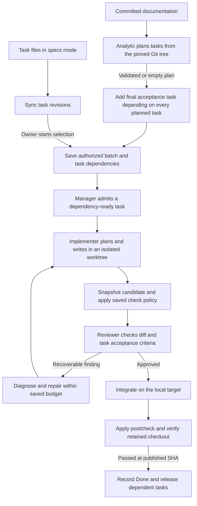

# How BOSS delivers a project from Markdown

BOSS is a local macOS coordinator. Phoenix LiveView accepts the owner's Start, SQLite records the authorized work, and a supervised Manager drives installed agent CLIs and Git. Closing the dashboard leaves admitted work running. The delivery destination is an existing **local Git branch**. The owner's checkout can stay at its original commit.

## Where the work starts

| Starting material | What registration and Start do |
| --- | --- |
| Plain directory, unborn Git branch, or a brief only at the repository root | Registration needs a local branch with a commit and an existing source directory strictly inside the working tree. The owner initializes Git and places the brief in a subdirectory. |
| One committed product brief such as `docs/product.md` | Choose **Plan tasks from documentation**. A blank target creates `boss/autopilot/<UUID>` at the current commit. Start reads the Markdown blobs from the selected target commit, so commit the brief **before registration**. |
| One independently executable task per Markdown file | Use specs mode. The importer reads the working files into immutable task revisions. New file imports can add Backlog cards. A blank base uses the current branch, so select an existing, unchecked-out target before running Autopilot. |

## The execution path



| Owner in the code | What it controls |
| --- | --- |
| [Projects](../lib/boss/projects.ex) and [Repository](../lib/boss/projects/repository.ex) | Validate the selected paths and Git base. Documentation registration can create a publication ref without switching the user's checkout. |
| [Intake](../lib/boss/projects/intake.ex) and [Planner](../lib/boss/projects/intake/planner.ex) | Pin the source commit, validate source references and the dependency graph, then save generated revisions and their batch atomically. New intakes allow up to three planning attempts in 20 minutes and at most 32 tasks. New documentation Starts pin the loop choice and add a final acceptance task in the same transaction, including when the planner returns zero tasks. |
| [Manager](../lib/boss/runs/manager.ex) and [Autopilot](../lib/boss/deliveries/autopilot.ex) | Own workers and admission. A prerequisite must reach Done. The parallel scheduler admits eligible independent work up to the available implementer pool and saved capacity. Integration is exclusive. |
| [Delivery worker](../lib/boss/deliveries/worker.ex) and [check configuration](../lib/boss/checks/command.ex) | Pin task criteria, implementation workspace, check configuration and reviewer evidence. An explicit command runs against the candidate. A blank command selects `spec_only`, which verifies Git integrity and delegates criterion assessment to the reviewer. |
| [Integration worker](../lib/boss/deliveries/integration_worker.ex) | Publish the approved SHA, or check and review a merge candidate if the target moved. Reapply the saved check policy after publication and verify the retained checkout before recording Done. A failed postcheck can leave a published commit requiring attention. |

## Whole-brief acceptance

The final task, **Verify the complete project brief**, depends on every task the planner produced. SQLite binds it to the intake, original source revision and committed documents. Every nonblank source line belongs to a stable range. A plan must retain all ranges. The reviewer receives the original Markdown, the cumulative diff from the intake commit, and actual check output for the candidate. Approval must cover every range, including when an advanced target requires a fresh merge review. Missing evidence can trigger the normal bounded repair cycle. The whole-brief result applies to the exact published SHA after its postcheck.

On a replan the cumulative diff starts at the new intake commit. Features already present at that commit may have no diff. The check should exercise retained behavior too, especially for a reviewer that can only see supplied evidence.

The owner supplies an executable check for a new documentation Start. That command also runs on intermediate candidates, so choose one that can verify the project incrementally. A broad brief can contain usability or deployment requirements beyond what local execution establishes. The reviewer must flag missing evidence. Ordinary specs-mode workflows still support specification-only review.

- **First Start and replay.** BOSS saves the loop choice and parallel setting before planning. Single pass disables a second spec-rework pass. Multiple implementers affect concurrency. Replaying the same authorization keeps those choices.
- **Later changes to the brief.** Once a versioned project finishes, commit revised documentation on its registered target and choose **Replan changed documentation**. The target must still contain the previous verified publication. The new intake keeps its own source, tasks and verification. Unchanged documents do not authorize a new planner call. Historical requests retain their saved behavior.
- **Rework of task files.** Reviewer feedback becomes a derived database revision linked to the last observed file. The source file and its frontmatter remain intact. The importer still detects later edits and moves against that file observation.
- **Blocked work.** A failed prerequisite can leave dependents queued until the owner resolves it. Provider failure, uncertain cleanup or a server restart can also require attention. [Autopilot controls](AUTOPILOT.md) · [Recovery](RECOVERY.md)

## Acceptance evidence

The native macOS test starts with exactly one committed file, `docs/product.md`. It specifies a greeting CLI with three observable behaviors: default greeting, a name containing a space, and an error for extra arguments. A trusted check outside the repository asserts exit status, stdout and stderr for all three. The test runs that check in a fresh checkout of the exact published SHA and inspects the independent review, postcheck and retained checkout.

Companion scenarios cover an empty planner result and an implementation that passes a narrower task check while missing two requirements. The finite CLI supplies controlled model responses. Git, process supervision, Python execution, SQLite and the delivery gates are real.

```sh
rtk proxy asdf exec mix test test/boss/autopilot_native_test.exs --only greenfield
```

See the [executable acceptance cases](../test/fixtures/greenfield_brief_check.py) and [native end-to-end test](../test/boss/autopilot_native_test.exs). Live-model quality and deployment require separate evidence.
