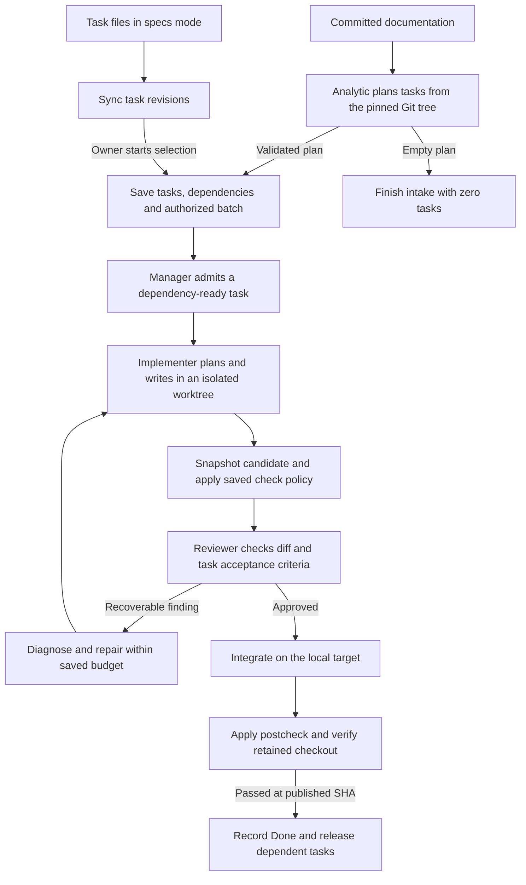

# How BOSS delivers a project from Markdown

BOSS is a local macOS coordinator. Phoenix LiveView accepts the owner's Start, SQLite records the authorized work, and a supervised Manager drives installed agent CLIs and Git. Closing the dashboard leaves admitted work running. The delivery destination is an existing **local Git branch**. The owner's checkout can stay at its original commit.

## Where the work starts

| Starting material | What registration and Start do |
| --- | --- |
| Plain directory, unborn Git branch, or a brief only at the repository root | Registration needs a local branch with a commit and an existing source directory strictly inside the working tree. The owner initializes Git and places the brief in a subdirectory. |
| One committed product brief such as `docs/product.md` | Choose **Plan tasks from documentation**. A blank target creates `boss/autopilot/<UUID>` at the current commit. Start reads the Markdown blobs from the selected target commit, so commit the brief **before registration**. |
| One independently executable task per Markdown file | Use specs mode. The importer reads the working files into immutable task revisions. New file imports can add Backlog cards. A blank base uses the current branch, so select an existing, unchecked-out target before running Autopilot. |

## The execution path



| Owner in the code | What it controls |
| --- | --- |
| [Projects](../lib/boss/projects.ex) and [Repository](../lib/boss/projects/repository.ex) | Validate the selected paths and Git base. Documentation registration can create a publication ref without switching the user's checkout. |
| [Intake](../lib/boss/projects/intake.ex) and [Planner](../lib/boss/projects/intake/planner.ex) | Pin the source commit, validate source references and the dependency graph, then save generated revisions and their batch atomically. New intakes allow up to three planning attempts in 20 minutes and at most 32 tasks. A finished intake is consumed, including an empty plan. |
| [Manager](../lib/boss/runs/manager.ex) and [Autopilot](../lib/boss/deliveries/autopilot.ex) | Own workers and admission. A prerequisite must reach Done. The parallel scheduler admits eligible independent work up to the available implementer pool and saved capacity. Integration is exclusive. |
| [Delivery worker](../lib/boss/deliveries/worker.ex) and [check configuration](../lib/boss/checks/command.ex) | Pin task criteria, implementation workspace, check configuration and reviewer evidence. An explicit command runs against the candidate. A blank command selects `spec_only`, which verifies Git integrity and delegates criterion assessment to the reviewer. |
| [Integration worker](../lib/boss/deliveries/integration_worker.ex) | Publish the approved SHA, or check and review a merge candidate if the target moved. Reapply the saved check policy after publication and verify the retained checkout before recording Done. A failed postcheck can leave a published commit requiring attention. |

## Limits that affect unattended delivery

- **The first documentation Start ignores the loop selector.** The UI sends the check and reviewer to intake. At batch creation, intake enables parallel work and a possible second spec-rework pass for a pool larger than one. With zero or one binding it selects sequential, single-pass execution. A visible **Single pass** can therefore result in additional model calls with a multi-implementer pool. Subsequent task-based Starts pass the loop selection through. [UI handoff](../lib/boss_web/components/autopilot.ex) · [Intake batch creation](../lib/boss/projects/intake.ex)
- **Done covers the tasks the planner produced.** A valid plan may omit a requirement or contain zero tasks. There is no final independent comparison of the published application with the entire original brief. Later edits to documentation do not trigger a second intake. Supply a trusted executable check when the result must demonstrably run. The command applies to each task and its postcheck, so it must make sense at intermediate commits too.
- **A blocked prerequisite can end the batch.** When its dependents are queued and nothing else can run, the scheduler can stop before reaching the end-of-pass rework step. Provider failures, exhausted recovery and interrupted work can also require owner action. A server restart pauses unstarted work. [Autopilot controls](AUTOPILOT.md) · [Recovery](RECOVERY.md)
- **Specs-mode rework can modify the source file.** It constructs text from the pinned revision and writes the file before recording and adopting the new revision. A newer edit at that path can be overwritten. Documentation-mode generated revisions stay in SQLite. [Spec rework](../lib/boss/deliveries/spec_rework.ex)

## Acceptance evidence

The macOS greenfield fixture starts from exactly one committed file, `docs/product.md`. It invokes the public registration and documentation Start APIs with the current migration set. Its finite Codex substitute supplies a task, implementation and review. BOSS runs the native CLI transport, real Git operations, and a trusted Python output assertion. The test checks that both the candidate check and postcheck recorded the expected stdout digest and exact SHA. It verifies the completed batch, task state, target ref and retained checkout, then runs `hello.py` from a fresh checkout of that SHA. The original checkout remains clean at its starting commit.

```sh
rtk proxy asdf exec mix test test/boss/autopilot_native_test.exs --only greenfield
```

For the example brief “Running hello.py prints hello”, enter this as the check in the project panel (Python 3 must be on the host PATH):

```text
python3 -c "import subprocess,sys; out=subprocess.check_output([sys.executable,'hello.py']); sys.stdout.buffer.write(out); sys.exit(out.strip() != b'hello')"
```

This measures orchestration for a small executable. Live-model planning, completeness of a larger product brief, packaging, and Linux execution require separate evidence. The [Autopilot guide](AUTOPILOT.md) covers operator controls and recovery. The [product plan](../BOSS_PLAN.md) describes the intended system.
