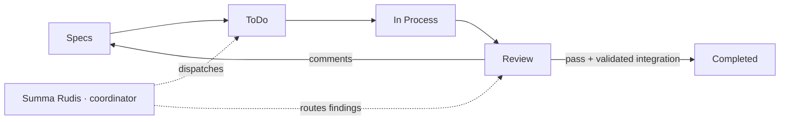

# Workflow contract

R060s can pause a new-policy battle after verifying one complete retained combined
candidate following restart. Resume remains explicit and revalidates the saved
bindings; configured checks and independent review run against that candidate
before integration. No work repeats, no reviewed head advances from inspection,
and late/fenced proof permits Stop only. Missing proof stays in Inspect.

With R060r new Starts, verified task-local blockers keep their cards unfinished
while independent ready work continues after a clean worker drain. Dependents wait;
shared/uncertain failures stop the Arena. Pause/restart still require Resume.
Final review waits for every task's completion or explicit Skip/defer decisions.
The existing single Start and frozen criteria/bindings/budgets remain unchanged.

The normal Arena journey is **Add folder → Create tasks → Start**. Agents and
Team are reusable setup, not steps repeated for each project or card.
[Product](PRODUCT.md) owns the story; [UI](UI_DASHBOARD.md) owns the screens.
The autonomous flow below is the target. Current planning and setup operations
are described in [Development](DEVELOPMENT.md). R050e implements the first
bounded Codex/Cursor Start loop, extended by independent task waves in R070d;
[Arena loop](ARENA_LOOP.md) states its limits. Full recovery and real-provider
parallel/custom-stage acceptance below remain target behavior.

## Add folder

Use the native folder chooser, default the Arena name from the folder and inherit
the saved team. Registration creates the default Tabula with Specs, ToDo,
In Process, Review and Completed. Open that board immediately. Creating another
board and changing columns belong in Advanced. **Board team** beside the board
title previews and explicitly adopts saved roles/models for future work. Existing
board assignments never change just because Home, Team or an Arena is opened.
Existing boards, drafts and immutable team revisions remain intact.
Repair links carry validated Arena/Tabula IDs through Team. Save offers a direct
return to that board's team review. **Use saved team** is the single explicit
confirmation action, with form-key/current/default revision and session guards;
Save/navigation cannot adopt. Equivalent role definitions need no adoption.
History retains its original revisions; active planning still blocks team changes.

Registration reads directory metadata only. It starts no agent or Git mutation.
Folder analysis and drafting must work without Git. If execution later needs Git
initialization or an initial commit, show the exact effect and required consent
in the Arena; declining leaves the folder, tasks and planning usable.

## Saved connections

Each roster entry has confirmed Disconnect. It clears that exact agent from all
current team scopes through new immutable versions and initiates private-profile
logout when its executable is verified. If verification is unavailable, R080b
disconnects it locally without running the program; provider authorization becomes
Unknown and the retained receipt/UI explicitly says sign-out was not attempted.
Its private profile stays intact. Other assignments and historical work remain unchanged. An unfinished
battle using the connection blocks disconnect; stop/finish it first. Reconnecting
requires explicit role selection again, including after a failed logout.

A saved Agent–Role binding does not expire on the catalog's 24-hour picker timer.
A successful last observation with unchanged executable/account/model metadata can
be reused; native dispatch still validates the actual account/model. Failed or
invalidated observations block until repaired. Picking new models and optional
model diagnostics retain the 24-hour freshness requirement.

## Create tasks

The user asks the saved Speculator to analyze the folder, optionally adding a
brief. Inspect `docs/` first, then relevant eligible project files. No manual path
list or separate import button per task is required for new requests.

The action explains its bounded read scope and provider usage. The host inventories
and snapshots eligible sources, records paths/hashes and skipped/truncated entries,
then sends frozen untrusted text to the planning runtime. Files never become policy
or grant tools, live filesystem access or execution. Exact policy/limits must be
versioned and tested. R040l implements the bounded folder reader alongside manual selection.
An empty folder requires a brief; insufficient or conflicting sources prompt a
useful clarification. Show progress and Cancel; retain evidence across reconnects.

Validate the response, criteria, citation scope and acyclic dependencies before
creating cards automatically. Persist the proposal-to-card receipts and events
atomically, once per source suggestion. Reanalysis preserves user edits and
running/completed history; new work remains visibly distinguishable. Model text
cannot approve check commands or broaden authority. Users may edit cards but do
not have to accept/import each one or produce a private Markdown artifact manually.

R040m implements this atomic card creation for newly consented planning requests.
A new analysis adds its own graph and preserves existing cards; it does not merge
similar tasks by inferred meaning. Legacy requests retain explicit imports.
Each generated card includes expected outcomes and concrete verification
instructions in its acceptance criteria. These are task requirements, not executable
command policy. Cards are planning drafts, not accepted delivery or execution authorization.
R050q also proposes fixed npm-test/Mix-test profiles when the sources support
them. Each has a relative folder and time limit, visible and editable inside the
same task dialog. No Advanced command declaration is needed for these profiles.
Unsupported verification stays in the criteria; it is not silently discarded.

## Start

**Start** is the one visible execution action; Run, Fight and Start battle mean
the same battle, not additional modes. Keep the user on the same Arena board.
Show one compact scope summary beside it: task membership/goal, saved team/models,
local completion boundary, approved checks and finite limits. Contextual missing
requirements explain the smallest repair. Do not send the user through separate
Describe, Battle preview, accepted-spec or manual worktree setup ceremonies.

The explicit Start action freezes bounded local authority after fresh admission.
It is separate from Create tasks' read/provider-use intent. Prepare and verify
owned worktrees under that authority. Manual pre-battle spec acceptance and
worktree tools remain optional inspection/setup utilities. Ordinary spec refinement,
implementation, checks and review need no repeated human approval after Start.
For planned profiles, each task runs its own checks plus those of integrated work
and any explicitly configured Arena checks. Final verification covers all retained
tasks and configured checks. Skipped/deferred task profiles do not become final
requirements, while configured checks always remain. Empty check subsets still
require independent inspection. Checks run offline in Linux without downloaded
project dependencies; missing required evidence blocks completion.
Protected policy changes, newly requested access and remote publication remain
separate decisions. Until execution exists, explain its absence beside a disabled
Start control; do not turn a preview into a pretend successful run.

New unrelated tasks wait for the next battle. In-scope task splits/repairs retain
original criteria and lineage, require host validation and consume the original
lifetime task budget. Team, workflow and check changes affect future work; never
substitute a runtime/model or rewrite the running snapshot silently.

## Automatic card movement

| Column / stable key | Assigned role | Exit condition |
| --- | --- | --- |
| Specs / `specs` | Speculator | Valid spec, criteria and dependencies |
| ToDo / `todo` | Summa Rudis coordinates the queue | Dependencies integrated, grants valid, capacity available |
| In Process / `in_process` | Implementor | Candidate revision and verification evidence |
| Review / `review` | Secutor | Independent pass with evidence, comments or blocker |
| Completed / `completed` | Host validates the Secutor result | Reviewed local integration and required checks passed |

Summa Rudis coordinates tasks and resolves process questions; Secutor judges
completion independently. A rejected candidate returns with spec revision,
findings and failed-check receipts to Speculator, then Implementor. The user does
not drag cards to keep ordinary work moving. No coordinator or manual move can
override a failed review or turn an unreviewed candidate into Completed.

Advanced → Board columns renames the five required columns and adds/reorders up
to four custom roles before or after Implementor. Each explicitly declares read
or read/edit access; read is the default. All run after Speculator and before
independent Secutor review. Every writer captures cumulative edit evidence; later
roles verify that checkpoint. Custom stages cannot run commands or complete work.
Active work blocks edits; Start freezes the exact definition/bindings/grants.
Historical workflows retain their permissions. Changes after review require a
new reviewed candidate; no conditional graph editor is needed.

## Durable coordination

1. Read committed battle state, eligible tasks, public reports and remaining
   limits. Invoke Summa Rudis for a decision/event, not a busy polling conversation.
2. Request a closed proposal: dispatch, route findings, request in-scope replanning,
   wait with a reason, request clarification or propose finish.
3. Phoenix validates battle/revision, membership, role, spec/candidate, grants,
   prerequisites, capacity and idempotency key.
4. Commit the command, projection and event together before supervised dispatch
   and LiveView notification. Cards and both dashboards reflect those records.
5. Reject stale/foreign/invalid proposals without side effects. A bounded correction
   turn cannot reset budgets or create new authority.

Phoenix owns scheduling mechanics and leases. SQLite owns workflow state.
Summa Rudis is a distinct saved role, not a hidden Speculator turn. Models never
receive direct SQL or privileged host APIs. Project check definitions require
explicit user-authored revisions and consent; proposals cannot activate policy.
Extra command declarations are optional Advanced settings. New battles without
them still require task and final Secutor review of the frozen task checks; no
command stages run. An empty command list never proves tests passed. Missing
required runtime evidence blocks completion. Configured commands remain required.

## States and controls

A card has a column plus execution status: `idle`, `queued`, `running`,
`paused`, `blocked`, `completed`, `skipped` or `cancelled`.
The workflow definition controls allowed column transitions; status alone cannot
satisfy a gate. A blocked card stays in the relevant column with a text reason.

Battle states: `ready`, `running`, `pausing`, `paused`,
`needs_attention`, `stopping`, `stopped`, `partial`, `completed`.
Waiting/backoff and sleep are recorded reasons, not fake completion states.

Implemented R060a Pause is a completed-stage boundary: the current bounded
stage finishes and verifies cleanup, then dispatch stops. Resume continues the
saved next stage within the original two-hour wall deadline and role/review
limits. Paused time still counts. Clean pauses survive restart; uncertain or
interrupted pausing work cannot Resume. R060b implements explicit Retry for settled
transient provider failures: two per task and two shared by final stages, frozen
at Start. Failed writers return through fresh preparation/coordinator/Speculator;
read-only roles repeat only their failed stage; configured custom writers use the same fresh-worktree retry as Implementor. Preserve failed receipts and all
consumed limits. Rejected/blocked reviews, native failures, old snapshots and
uncertain effects do not qualify. R060c adds confirmed Skip at a clean paused task
or settled task-local block/transient failure/review exhaustion. Its transitive
dependents are deferred; independent work continues from the reviewed head.
Paused battles stay paused. Final review/checks cover retained work and omissions
are explicitly unfinished: the terminal result is Partial, never Completed.
All-omitted work stops without inference if no task completed. Broader recovery
remains a target; native/policy failures and final stages cannot be skipped.

R060j adds automatic 5/20-second waits for known settled connection, busy-profile,
timeout or launch failures in new Starts. Show Waiting to retry with the exact
role/runtime/model, remaining wait, allowance and Cancel automatic retry.
These waits share the existing retry budget/deadline; generic provider errors
stay manual. Due admission rechecks bindings and eligibility. Restart cancels the
wait and leaves an explicit Retry; old Starts retain their original contract.

R060q freezes v2 for new Starts: explicit Codex overload additionally waits
5–7/20–22 seconds with bounded jitter, within those same retry limits. Usage or
session exhaustion stops without retry; HTTP 429 offers manual Retry after a
wait because quota and throttling are not distinguished. UI explains the reason;
no role/account/model substitution occurs. Historical v1 waits remain unchanged.

R060d recovers fully settled running/pausing boundaries as Paused after restart.
It records the recovery reason/control revision and waits for explicit Resume.
Keep the exact next stage, all attempts, omissions, counters and original deadline.
Unfinished attempts, unconsumed failures and missing cleanup still require inspection;
no restart automatically dispatches or retries a stage.

R060e keeps late results as expired evidence while leaving the battle needing
attention. Inspect distinguishes the reported result from accepted work. Confirmed
Stop can close it when every worker has verified cleanup; unknown cleanup retains
the Arena lock. Late evidence never advances a card or enables Resume/Retry/Skip.

| Control | Meaning |
| --- | --- |
| Pause | Close admission immediately; checkpoint and quiesce owned workers, then show Paused only once verified |
| Resume | Revalidate authority, processes, worktrees and limits, then continue from durable evidence |
| Retry | New recorded attempt for an eligible failed stage, retaining prior artifacts and consumed limits |
| Stop | Confirm; close admission, cancel owned workers, verify cleanup and preserve changes/history |
| Skip task | Confirm; retain unfinished work and defer dependents; never count it completed |
| Inspect | Open task, evidence, worktree or redacted logs without altering execution |

If a runtime cannot resume a live session, checkpoint public evidence, end the
owned process and use a fresh compatible session. The UI states what will happen.
No automatic restart may replay an uncertain write.

Defaults proposed for the first implementation: two concurrent task workers per
Arena, four active agent sessions globally (including planning, review and
Summa Rudis), 20 lifetime tasks per battle, two transient retries per task,
three Secutor review attempts per task, four active hours and 24 wall hours per
battle. These are editable, finite start-time settings, not measurements.
Backoff, corrections, splits and continuations do not reset cumulative budgets.
Sleep consumes wall time but not active time. Cost telemetry is advisory if
provider usage is missing/delayed; do not claim a guaranteed billing cap.

Task-local blockers pause descendants while independent work continues. Invalid
policy, uncertain process ownership or Arena-wide Git drift closes that Arena's
admission. Other Arenas keep working. Once no work can advance, show Needs
attention with the cause and smallest useful question. Auth/quota recovery is
handled once for the affected connection.

## Parallel workers and Git integration

Implemented R070a permits two global stage workers; R070d adds independent-task
implementation waves of up to two within one board. Prerequisites must already be
integrated. Exact saved connections take one provider turn at a time, and capacity
waits add no attempts/turns. Checks/review/integration run serially after the wave;
changed-head candidates need a new combined review, and conflicts return through
bounded fresh-worktree repair. Old snapshots remain sequential. Additional
provider-account concurrency proof and broader recovery below
remain required target work, not implemented acceptance.

A clone is a new attempt/session using the same role definition, not a duplicated
login or shared writable checkout. Atomically claim tasks and capacity; retain
lease TTL/heartbeat and one active attempt per task/stage. Apply global, Arena,
Tabula and provider-account caps with fair admission across Arenas. Idle
coordinator conversations hold no worker slot.

Allow one active battle per Arena initially, with multiple saved Tabulae.
Independent Arenas and independent tasks in that battle may run concurrently.
This avoids competing integration branches without removing requested task
parallelism.

Every task branches from a recorded reviewed battle head, after prerequisites
have integrated. Each task has its own worktree, process group and optional
ports. Secutor reviews the exact task candidate and its evidence.

Local integration into the battle branch is serialized. If the reviewed head
has advanced, form a new integration candidate in an owned integration worktree,
run affected checks and obtain Secutor review of the combined candidate before
advancing the head with a compare-and-swap. A conflict returns to Speculator/
Implementor as bounded repair work. Never force-reset a task or the user's
checkout. Persist integration intent and candidate identity before Git effects;
on crash reconcile refs before retrying. One task's pass is not evidence for a
different combined revision.

A task reaches Completed only after its reviewed contribution is integrated.
Dependents use that integrated head. The whole battle completes only when every
required criterion is met, no required tasks remain blocked/skipped/cancelled,
final checks pass on the final head, and Secutor records a final independent
review. Summa Rudis summarizes the result; the host records completion. Local
integration is part of Start authority; user-branch merge/push is separate.

## Worktree preparation (R050b)

Repository setup → fresh committed Git observation → separate confirmation →
durable `worktree_arena_git` → native owned checkout → retained receipt.
Pending → running → completed/failed; cancellation waits for cleanup. Expired
running/cancelling commands become interrupted without replay. A mismatched
key/HEAD/path or late result cannot publish success. Original checkout changes
stay outside the new worktree. This optional setup action neither freezes a battle
nor authorizes agents/checks; the read-only Battle preview stays read-only.

## Retained worktree inspection (R050c)

Completed preparation → **Inspect worktree** → durable preparation-bound command →
verify ownership/registration → compare index and raw tracked bytes → dated result.
Extra files are flagged without reading their contents. No checkbox is needed for
this non-mutating local inspection. Pending/running/cancelling and interruption
follow the existing Git ledger; explicit inspection can be requested again with a
new command, while replaying an old key returns its original result. Unchanged,
changed and unverifiable are observations, never admission or execution authority.
Source Git observations and the read-only Battle preview remain separate.

## Multiple agent setup (R020i)

Agents roster → Add agent → name + runtime → Connect and Authorize → Select
models → Save. Edit opens the same wizard for one connection; all other profiles
and choices remain intact. Team chooses a connection independently for each role,
then shows only that connection's saved model choices. Changing the agent clears
that role's unsaved model choice. Saving a new default team does not alter any
Arena/Tabula's existing revision. Codex/Cursor initial planning defaults to the assigned
Speculator. Create tasks → Planning role optionally chooses another saved board
role. Its exact role/team/connection/model/sources are frozen in usage consent;
changing the choice clears consent without discarding brief/source selections.
Foreign/removed roles stay unavailable instead of falling back. This is a
planning-only request, not team adoption or a custom battle stage. Reopening the
dialog in a new LiveView starts with Speculator; retained history names the role
that actually produced each request.
Cursor uses its separate no-tools planning grant, never a Codex fallback.

## Optional second role workers (R070e)

Within Team, Additional worker is optional and uses another named connection and
selected model. Save/adoption keeps the normal scoped flow. New Start freezes
primary/extra bindings and assigns wave tasks to slot 0/1 without dynamic fallback.
A missing extra shares the primary; an assigned unavailable extra blocks, while a
busy one waits. Extra-equipped waves prioritize earlier planning stages, enabling
two writers after shared planning turns. Review repair/Retry keeps the same slot;
final review and configured checks retain primaries. Disconnect clears its exact
bindings from both positions in current teams. Past Starts/teams remain intact.
